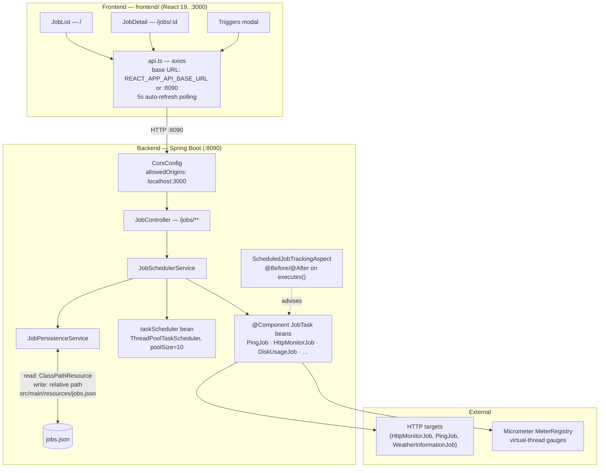
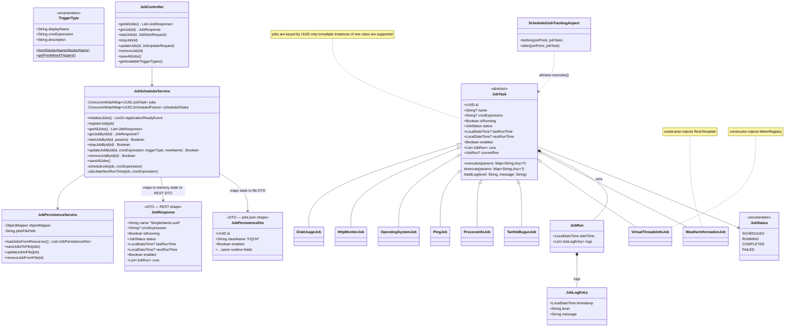
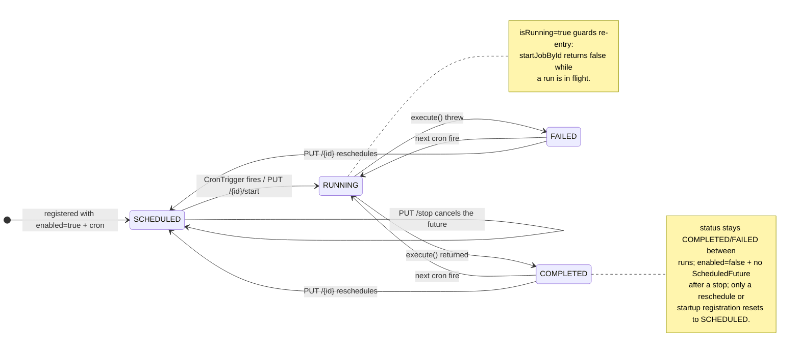
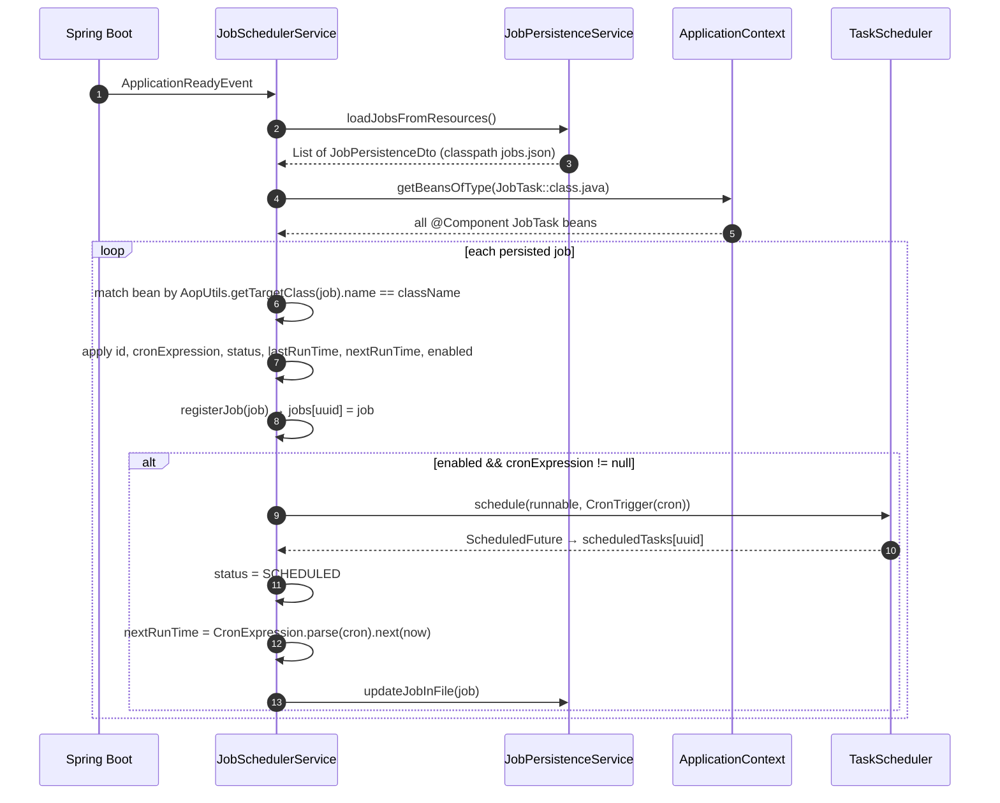
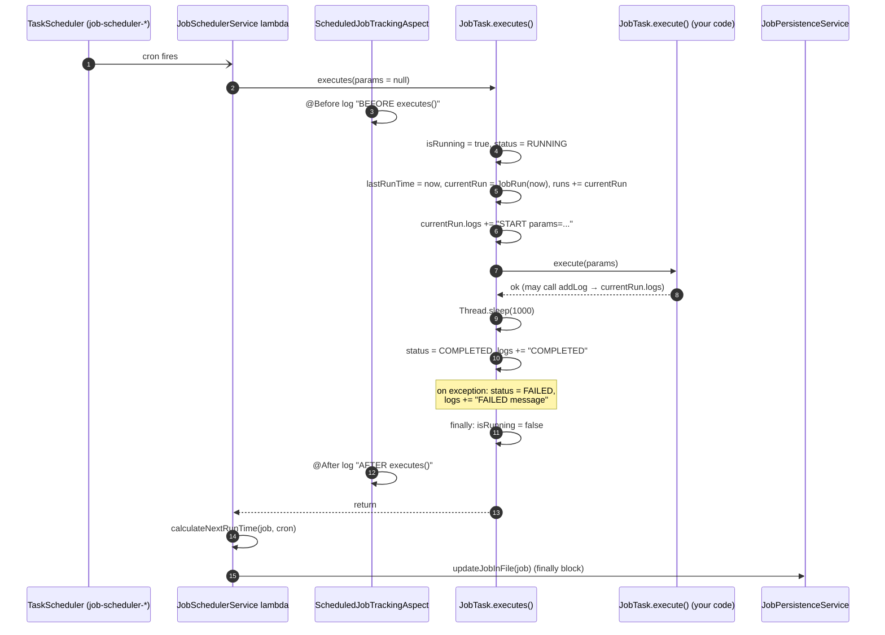
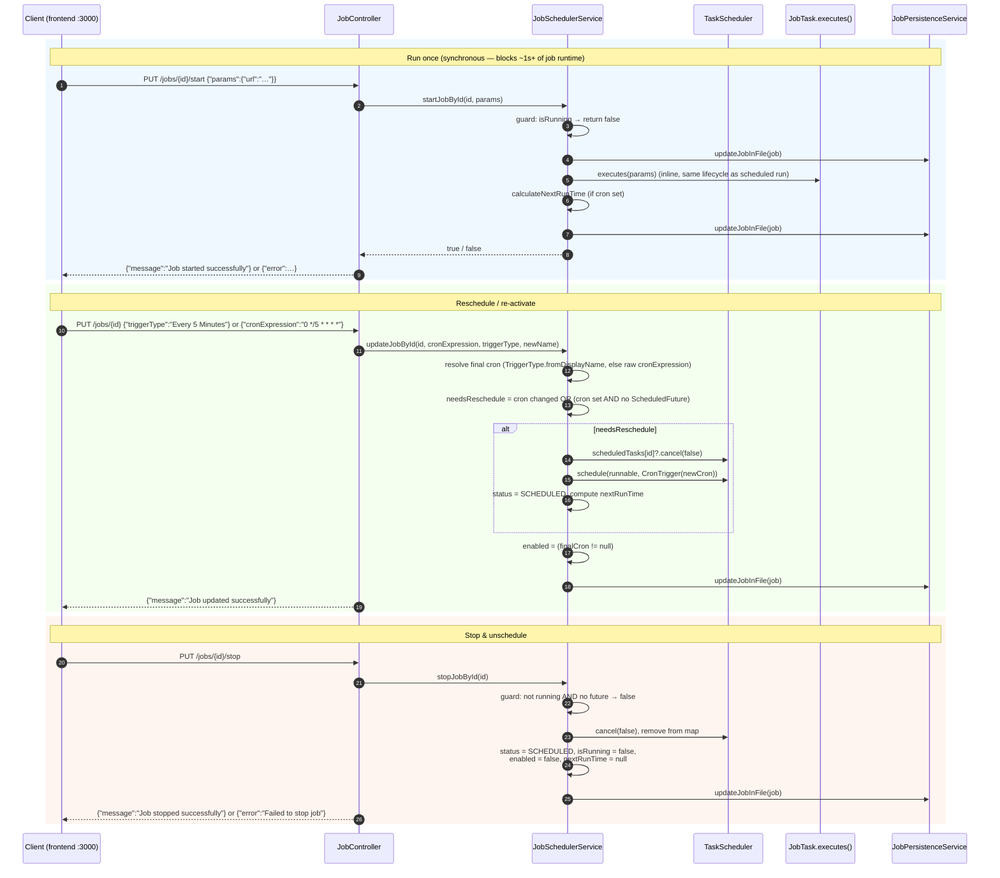
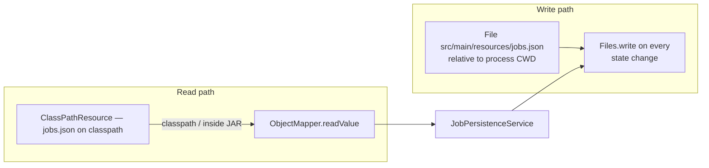

# Dynamic Scheduled Tasks

This project is a lightweight, extensible job scheduler built with Kotlin and Spring Boot. Job classes are plain `@Component`s extending an abstract `JobTask`; the scheduler restores their state from `jobs.json`, arms cron triggers, and exposes a REST API to run, stop, and reschedule jobs at runtime.

- **Backend**: repo root — Kotlin 2.2.21, Spring Boot 3.5.13, JDK 21, Gradle 9.6 wrapper (single project, no `settings.gradle`), listens on **:8090**
- **Frontend**: `frontend/` — React 19 + TypeScript via CRA (`react-scripts` 5), axios, react-router-dom 7, dev server on **:3000** (separate npm project; Gradle never builds it)
- **Deploy**: multi-stage `Dockerfile`, `docker-compose.yml`, Kubernetes manifests in `k8s/`

## Table of contents

- [Architecture](#architecture)
- [Domain model (UML)](#domain-model-uml)
- [Job lifecycle (state machine)](#job-lifecycle-state-machine)
- [Flows](#flows)
- [Persistence](#persistence-jobsjson)
- [REST API](#rest-api)
- [Cron expressions & triggers](#cron-expressions--triggers)
- [Frontend](#frontend)
- [Project structure](#project-structure)
- [Running locally](#running-locally)
- [Configuration](#configuration)
- [Adding a new job](#adding-a-new-job)
- [Known quirks](#known-quirks)

## Architecture

Two independent apps. The browser UI calls the backend over REST; CORS on the backend only allows `http://localhost:3000`.



Wiring facts an agent needs:

- `config/SchedulingConfig.kt` is both a `@Configuration` **and** a servlet filter (logs virtual/platform thread per request). It defines `taskScheduler` (inject with `@Qualifier("taskScheduler")`), `scheduledExecutorService`, `restTemplate`, and two `RestClient` variants — `@Primary` for non-`local` profiles and a trust-all-SSL one under the `local` profile.
- `config/ScheduledJobTrackingAspect.kt` advises `JobTask+.executes(..)` and only logs BEFORE/AFTER; it does not alter behavior.
- Virtual threads are enabled (`spring.threads.virtual.enabled: true`); jobs themselves run on the `job-scheduler-` pool threads.

## Domain model (UML)



Identity is split in two places and must stay consistent:

- **In memory / REST**: keyed by `UUID`; responses expose `name = "SimpleClassName:uuid"`. The frontend parses the UUID out of `name` (`frontend/src/api.ts`).
- **In `jobs.json`**: keyed by `className` = **FQCN of the AOP target class** (`AopUtils.getTargetClass(job).name`), matched back to beans on startup.

## Job lifecycle (state machine)

`status` transitions performed by `JobTask.executes()` and `JobSchedulerService`:



`executes()` is the lifecycle wrapper: it sets `RUNNING`, appends a `JobRun` with `START`/`COMPLETED`/`FAILED` log entries, calls your `execute()`, sleeps 1s (demo pacing), and resets `isRunning` in `finally`. **Never override `executes()`** — put logic in `execute()`.

## Flows

### Startup & state restoration

`initializeJobs()` runs on `ApplicationReadyEvent`. Only job classes that have an entry in `jobs.json` are registered — a `@Component` `JobTask` **without** a persisted entry is never inserted into the in-memory map and will not appear in the REST list (see [Known quirks](#known-quirks)).



### Scheduled execution

The runnable registered with `TaskScheduler` wraps `executes()` with next-run computation and persistence; the AOP aspect brackets the whole call:



### REST control plane (start / update / stop)

Note that mutation endpoints return `{message}` or `{error}` maps with **HTTP 200**, not a `JobResponse` — the UI re-fetches the job after each mutation.



## Persistence (`jobs.json`)

Read/write asymmetry — the single biggest operational gotcha:



- **Reads** come from the classpath (the packaged resource).
- **Writes** go to the relative path `src/main/resources/jobs.json`. Running `./gradlew bootRun` from the repo root **mutates the tracked file** — expect a dirty git diff after exercising jobs; don't commit that churn unintentionally. Inside Docker/k8s the path resolves nowhere useful, so runtime state is not persisted there.
- The file's `ObjectMapper` writes `LocalDateTime` as arrays (`[2025, 8, 26, 12, 51, 0, 2440000]`); the REST layer uses Spring's mapper with `write-dates-as-timestamps: false` (ISO-8601 strings). The frontend normalizes both.

Schema (top-level wrapper plus one record; see the live file for the rest):

```json
{
  "jobs": [
    {
      "id": "881d188d-ad01-410d-bf65-752f665ef471",
      "cronExpression": "0 * * * * *",
      "isRunning": false,
      "status": "SCHEDULED",
      "lastRunTime": [2025, 8, 26, 12, 51, 0, 2440000],
      "nextRunTime": [2025, 8, 26, 13, 2],
      "className": "com.github.senocak.jobscheduler.jobs.DiskUsageJob",
      "enabled": false,
      "runs": []
    }
  ]
}
```

## REST API

Base path `/jobs` (`controller/JobController.kt`). Sample calls: `src/main/resources/generated-requests.http`.

| Method | Path | Body | Effect |
|---|---|---|---|
| GET | `/jobs` | — | All jobs as `JobResponse` (`name = "SimpleName:uuid"`) |
| GET | `/jobs/{id}` | — | Single job; unknown UUID throws `NoSuchElementException` (unmapped → HTTP 500) |
| PUT | `/jobs/{id}/start` | `{"params": {…}}` | Runs the job **synchronously** on the caller thread; returns `{"message"}` or `{"error"}` |
| PUT | `/jobs/{id}/stop` | — | Cancels the `ScheduledFuture`, sets `enabled=false`; `{"error"}` if not running/scheduled |
| PUT | `/jobs/{id}` | `{"cronExpression"?, "triggerType"?, "name"?}` | Reschedules/re-activates; `name` is accepted but **currently ignored** by the service |
| DELETE | `/jobs/{id}` | — | Unregisters the job and removes it from `jobs.json` |
| POST | `/jobs/save` | — | Serializes all in-memory jobs to `jobs.json` |
| GET | `/jobs/triggers` | — | Preset `TriggerType` list (`displayName`, `cronExpression`, `description`) |

Actuator is exposed on the same port: `health`, `info`, `metrics`, `prometheus`, `refresh`, `mappings` (health details always on).

## Cron expressions & triggers

Spring's **6-field** cron (not 5-field Unix): `second minute hour day-of-month month day-of-week`.

```
0 * * * * *        # every minute
0 */5 * * * *      # every 5 minutes
0 0 9 * * MON      # Mondays 09:00
```

`TriggerType` (in `model/TriggerType.kt`) provides presets (`Every Minute` … `Monthly on 1st`) plus `CUSTOM`. `updateJobById` resolves `triggerType` → cron by `displayName`; an unknown/`CUSTOM` displayName falls back to the raw `cronExpression` field.

## Frontend

```
App.tsx ── Router + navbar (Jobs link, Triggers modal)
├── JobList.tsx        /            search, badges, Run/Stop, auto-refresh
├── JobDetail.tsx      /jobs/:id    overview, schedule editor, Run once, runs
├── Triggers.tsx       (in modal)   preset table with copy-cron
├── components/Modal.tsx            Escape-to-close dialog shell
├── api.ts                          axios client + response normalization
└── util.ts                         time/JSON/cron helpers
```

Client behavior worth knowing (`frontend/src/api.ts`):

- Mutations (`startJob`, `stopJob`, `updateJob`) detect the backend's `{error}` maps, then **re-fetch** `/jobs/{id}` — the UI never treats a `{message}` response as job state.
- Job `name` is split on `:` to recover the UUID; timestamps may be ISO strings or Jackson arrays.
- Auto-refresh polls every 5s (toggleable) with silent loads so form state survives.
- The schedule editor validates 6-field cron client-side; the params textarea validates JSON before "Run now".

## Project structure

```
.
├── build.gradle.kts                 # Kotlin 2.2.21, Boot 3.5.13, JDK 21 toolchain
├── src/main/kotlin/com/github/senocak/jobscheduler/
│   ├── Application.kt               # @SpringBootApplication + @EnableScheduling, logger() ext
│   ├── config/
│   │   ├── SchedulingConfig.kt      # taskScheduler, RestClients (local = trust-all SSL), filter
│   │   ├── CorsConfig.kt            # localhost:3000 only
│   │   ├── RestClientInterceptor.kt # outbound request/response logging
│   │   └── ScheduledJobTrackingAspect.kt
│   ├── controller/JobController.kt  # REST /jobs
│   ├── dto/                         # JobResponse, JobPersistenceDto, JobStart/UpdateRequest
│   ├── jobs/                        # JobTask + 8 @Component implementations
│   ├── model/                       # JobStatus, TriggerType
│   └── service/                     # JobSchedulerService, JobPersistenceService
├── src/main/resources/
│   ├── application.yml
│   ├── jobs.json                    # runtime state — MUTATED at runtime
│   └── generated-requests.http
├── frontend/                        # CRA React app (own npm project)
├── k8s/                             # deployment.yaml (SERVER_PORT=8080), service.yaml
├── Dockerfile
└── docker-compose.yml               # backend on :8090
```

## Running locally

Backend (JDK 21; wrapper uses Gradle 9.6):

```bash
./gradlew compileKotlin   # fast type check
./gradlew test            # passes — there are no backend tests (src/test does not exist)
./gradlew bootRun         # http://localhost:8090
```

Frontend (inside `frontend/`):

```bash
npm install
npm start                 # http://localhost:3000
npm run build             # type-check + lint + bundle — the only real gate
CI=true npm test -- --watchAll=false --passWithNoTests   # no tests exist yet
```

Docker / Kubernetes:

```bash
docker compose up --build                # backend on :8090
docker build -t springboot-kotlin-k8s -f Dockerfile .
kubectl apply -f k8s/.                   # sets SERVER_PORT=8080; imagePullPolicy: Never
```

There is no ktlint/spotless/checkstyle task and no CI workflow. Verification order: `./gradlew build` → `cd frontend && npm run build`.

## Configuration

`application.yml` highlights:

| Key | Value | Note |
|---|---|---|
| `server.port` | `${SERVER_PORT:8090}` | k8s overrides to 8080 |
| `spring.threads.virtual.enabled` | `true` | request handling on virtual threads |
| `spring.jackson.serialization.write-dates-as-timestamps` | `false` | ISO-8601 in REST responses |
| `logging.level…scheduling` | `DEBUG` | Spring scheduling debug logs |
| `management.endpoints.web.exposure.include` | `health,info,metrics,prometheus,refresh,mappings` | |

Profiles: `local` swaps in a trust-all SSL `RestClient` (`SchedulingConfig`) for self-signed dev targets.

## Adding a new job

1. Create a class extending `JobTask` and annotate with `@Component`; implement `execute(params)` (optionally call `addLog(level, message)` to append to the current run).
2. **Add a matching entry to `jobs.json`** with the class's FQCN in `className` — `initializeJobs()` only registers jobs that have a persisted entry; an unmatched bean is silently ignored (it will not be listed or scheduled).
3. Set `enabled: true` and a `cronExpression` in that entry to have it scheduled on startup.

```kotlin
@Component
class MyJob : JobTask() {
    override fun execute(params: Map<String, Any>?) {
        val target: String = params?.get("target")?.toString() ?: "default"
        addLog(level = "INFO", message = "processed $target")
    }
}
```

```json
{
  "id": "0b6f1c1e-4b6a-4f6a-9d6e-000000000001",
  "cronExpression": "0 */5 * * * *",
  "isRunning": false,
  "status": "SCHEDULED",
  "lastRunTime": null,
  "nextRunTime": null,
  "className": "com.github.senocak.jobscheduler.jobs.MyJob",
  "enabled": true,
  "runs": []
}
```

## Known quirks

- **`jobs.json` write path is CWD-relative** (`src/main/resources/jobs.json`) while reads use the classpath — running from the repo root dirties the tracked file; containers don't persist state. See [Persistence](#persistence-jobsjson).
- **Jobs without a `jobs.json` entry are invisible** — bean discovery alone is not enough; registration happens only through `initializeJobs()` matching persisted `className`.
- **UUID-keyed identity**: multiple instances of one job class are supported; never assume one bean per class when parsing `name = "SimpleName:uuid"`.
- **6-field cron** everywhere (Spring format); the frontend enforces the field count, the backend accepts whatever string you send and logs schedule failures.
- **Mutations return `{message}`/`{error}` with HTTP 200** — check the body, then re-fetch job state.
- `JobUpdateRequest.name` is accepted by the API but currently unused by `updateJobById`.
- `JobTask.executes()` sleeps 1s after `execute()` — deliberate demo pacing; remove it if you need tight cycles.
- `Dockerfile` `EXPOSE 8080` is cosmetic; the local default port is 8090 and k8s sets `SERVER_PORT=8080`. The k8s deployment uses `imagePullPolicy: Never`, so the image must already exist in the cluster's local runtime.


## Run on K8S
### docker build -t springboot-kotlin-k8s -f Dockerfile .
### kubectl apply -f k8s/.